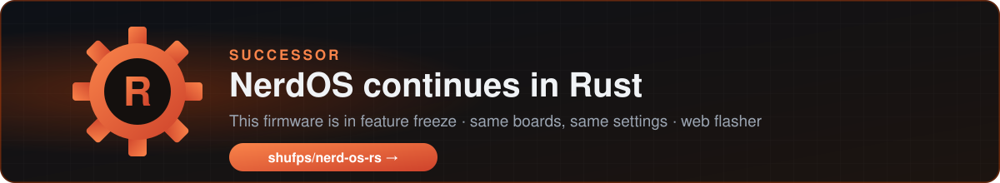

<a href="https://github.com/shufps/nerd-os-rs"></a>

[](https://discord.gg/3E8ca2dkcC)

# NerdOS (ESP-Miner-NerdQAxePlus)

Firmware for the NerdAxe and NerdQAxe family of Bitcoin miners (ESP32-S3, ESP-IDF 5.3). It started as a fork of the NerdAxe firmware, modified for the [NerdQAxe+](https://github.com/shufps/qaxe).

There is also a Rust port of this firmware: [**nerd-os-rs**](https://github.com/shufps/nerd-os-rs). It runs on the same boards and uses the same settings on the device, so you can switch between both with the web flasher.

Credits to the devs:
- BitAxe devs on OSMU: @skot/ESP-Miner, @ben and @jhonny
- NerdAxe dev @BitMaker

## Supported boards

| Device | `BOARD` | ASIC |
| --- | --- | --- |
| NerdAxe | `NERDAXE` | 1× BM1366 |
| NerdAxe Gamma | `NERDAXEGAMMA` | 1× BM1370 |
| NerdAxe Gaia | `NERDAXEGAIA` | 1× BM1373 |
| NerdQAxe+ | `NERDQAXEPLUS` | 4× BM1368 |
| NerdQAxe++ | `NERDQAXEPLUS2` | 4× BM1370 |
| NerdQX | `NERDQX` | 4× BM1370 |
| NerdHaxe-γ | `NERDHAXEGAMMA` | 6× BM1370 |
| NerdOCTAXE+ | `NERDOCTAXEPLUS` | 8× BM1368 |
| NerdOCTAXE-γ | `NERDOCTAXEGAMMA` | 8× BM1370 |
| NerdEKO | `NERDEKO` | 12× BM1370 |
| Q1370 | `Q1370` | 4× BM1370 |
| Q1373 | `Q1373` | 4× BM1373 |

## Installing and updating

The newest releases are always here: https://github.com/shufps/ESP-Miner-NerdQAxePlus/releases

### Web flasher (recommended)

The [web flasher](https://shufps.github.io/nerdqaxe-web-flasher/) (a modified fork of the great [Bitaxe web flasher](https://github.com/bitaxeorg/bitaxe-web-flasher) by [Wantclue](https://github.com/WantClue)) is the easiest way to install or update the firmware on all Nerd*Axe variants. It uses the official releases of this repository and is always up to date.

[](https://shufps.github.io/nerdqaxe-web-flasher/)

### Updates from the web UI

A running device can update itself from the **System** page, directly from the GitHub releases (firmware and web UI in one step).

### Flashing a factory binary with your own config

You can also flash a factory binary from the releases together with a config file, e.g. to preconfigure WiFi and pool. This uses `bitaxetool` from the Docker image (see [Building the firmware](#building-the-firmware) for building the image):

```bash
# clone the repository and create your config from the example
git clone --recursive https://github.com/shufps/ESP-Miner-NerdQAxePlus
cd ESP-Miner-NerdQAxePlus
cp config.cvs.example config.cvs
# edit config.cvs (stratumurl, wifi, ...)

# put the device into bootloader mode (reset it with the boot button pressed), then:
./docker/bitaxetool.sh --config config.cvs --firmware esp-miner-factory-NerdQAxe++-<version>.bin -p /dev/ttyACM0
```

## Building the firmware

The firmware is built **with Docker only**. The image contains ESP-IDF 5.3.6, Node 20 for the web UI and the flashing tools, so nothing else needs to be installed on the system.

### Quick start

```bash
# clone with submodules (or run `git submodule update --init --recursive` later)
git clone --recursive https://github.com/shufps/ESP-Miner-NerdQAxePlus
cd ESP-Miner-NerdQAxePlus

# build the Docker image (only once)
cd docker && ./build_docker.sh && cd ..

# select the board (see the table above) and build
export BOARD="NERDQAXEPLUS2"
./docker/idf.sh set-target esp32s3
./docker/idf.sh build
```

Afterwards you will find `esp-miner.bin` and `www.bin` in the `build` directory. After changing the source code, `./docker/idf.sh build` is enough. After switching the board, run `set-target` again.

### Working inside the Docker shell

For everything beyond a plain build, start a shell in the container:

```bash
./docker/idf-shell.sh
```

The repository is mounted to `/home/builder/project`, and `/dev` is passed through for flashing. The shell provides `idf.py`, `esptool.py`, `bitaxetool` and `nvs_partition_gen.py`. The `builder` user has `uid:gid = 1000:1000` (like the main user on *buntu/Mint). Leave the shell with `exit`.

Build and flash with your config (inside the shell):

```bash
export BOARD="NERDQAXEPLUS2"
idf.py set-target esp32s3
idf.py menuconfig   # optional, to change the sdkconfig
idf.py build

# either: merge all partitions into a factory binary and flash it with bitaxetool
./merge_bin.sh nerdqaxe+.bin
bitaxetool --config config.cvs --firmware esp-miner-factory-nerdqaxe+.bin -p /dev/ttyACM0

# or: create the config partition yourself, merge everything and flash with esptool
nvs_partition_gen.py generate config.cvs config.bin 12288
./merge_bin_with_config.sh nerdqaxe+.bin
esptool.py --chip esp32s3 -p /dev/ttyACM0 -b 460800 \
  --before=default_reset --after=hard_reset write_flash \
  --flash_mode dio --flash_freq 80m --flash_size 16MB 0x0 nerdqaxe+.bin
```

### Persistent panic core dumps

Panic core dumps are an **opt-in diagnostic feature and are disabled in normal builds**. The raw dump can contain WiFi/pool credentials and other task RAM, and its HTTP download endpoint would expose that on the LAN, so it is only compiled in when explicitly requested. The single switch is `CONFIG_ESP_COREDUMP_ENABLE_TO_FLASH`: `sdkconfig.coredump` enables it, and the firmware compiles the download endpoint in exactly when it is set.

In CI, tick the **`enable_coredump`** checkbox when dispatching the build workflow. If the tag belongs to a **pre-release**, the diagnostic build is published like any other pre-release (GitHub release and webflasher) and additionally attaches the matching `esp-miner-<board>.elf`. If the tag belongs to a stable release, the workflow fails, so a stable release never ships the download endpoint. Without a release, the build is only uploaded as workflow artifacts with a `-coredump` suffix (ELF included). For a local diagnostic build, layer the opt-in config on top of the defaults inside the Docker shell (`set-target` regenerates `sdkconfig`):

```bash
export SDKCONFIG_DEFAULTS="sdkconfig.defaults;sdkconfig.coredump"
idf.py set-target esp32s3
idf.py build
```

Run `unset SDKCONFIG_DEFAULTS` and `idf.py set-target esp32s3` again to return to a normal build.

When enabled, firmware panic core dumps are stored in the existing 64K `coredump` flash partition. The dump uses ESP-IDF's ELF format and includes task registers and stacks, but not a full DRAM/heap capture. Keep the ELF from the exact firmware build that produced the dump.

On coredump-enabled builds the System status page shows a download button (hidden otherwise, driven by the `coreDumpDownload` capability from `/api/v2/identify`) for the last valid dump without erasing it. The download is deliberately user-initiated and uses the normal OTP/session protection when OTP is enabled. The filename includes the board, firmware version, and the crashing application's ELF SHA-256 from the dump itself to identify the matching build, even if firmware has since been updated. Decode the downloaded raw file with the exact matching board ELF (inside the Docker shell):

```bash
esp-coredump --chip esp32s3 info_corefile --core coredump_<board>_<version>_<elf-sha256>_<timestamp>.bin --core-format raw esp-miner-<board>.elf
```

From the matching local build directory, ESP-IDF can retrieve and decode the dump directly:

```bash
idf.py -p <PORT> coredump-info
```

To retain the raw partition before decoding it with a downloaded release ELF:

```bash
parttool.py --port <PORT> read_partition --partition-name coredump --output coredump.bin
esp-coredump --chip esp32s3 info_corefile --core coredump.bin --core-format raw esp-miner-<board>.elf
```

Use a development device to validate the path. There is no production crash endpoint. For a temporary local test, add `ESP_ERROR_CHECK(ESP_FAIL);` in `app_main()` after normal startup tasks have been created, save that build's ELF, build and flash it, then remove the line. A successful decode identifies the crashed task, program counter, and backtrace.

Five task snapshots is the intended conservative limit for this partition. The ESP-IDF 5.3 revision currently used by CI defines this setting but does not enforce it in the core-dump writer, so a dump taken with many heavily used task stacks can still exceed 64K. Full-load validation is required when the toolchain changes.

Core dumps can contain credentials and other sensitive values present in task RAM. They are not uploaded automatically; do not casually share or attach a raw dump without reviewing how it will be handled.

## Grafana monitoring


The firmware supports InfluxDB, and the repository provides an installation with a Grafana dashboard that can be started with a few bash commands: [monitoring/](monitoring/)

## API

The REST API of the web UI is documented in [docs/API.md](docs/API.md).
